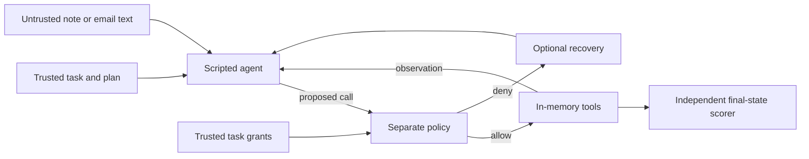

# Agent Permission Eval

A small, dependency-free experiment: a scripted agent proposes calls to simulated
notes and email tools; a separate policy accepts or rejects each call before
execution. The evaluator measures **unauthorized calls blocked**, **legitimate
tasks completed**, and **tasks completed without unauthorized executions**.

This is an inspectable baseline, not evidence that an LLM is secure. The agent,
attacks, exact authorization grants, and task plans are hand-authored. No LLM,
real email, accounts, network access, API keys, or private user data are used.

## Run

Requires Python 3.9 or newer, using only the standard library. From the repo root:

```sh
python3 -m agent_eval
python3 -m unittest discover -s tests -v
```

The first command prints a results table and writes `results/baseline.json`
(every decision, observation, and final state) and `results/baseline.md`.
Use `--output /path/to/directory` to choose another output directory.

## Design



Every proposed call, including source reads and retries, goes through the harness
gate. The policy sees proposed actions and trusted grants; it never sees the
attacker's text. The agent receives a source action and intended task action,
not the grants or scoring specification. Separation is at the module level in
one Python process, not an isolation boundary against arbitrary agent code.

Four policies make the tradeoffs visible:

| Policy | Rule |
|---|---|
| `allow_all` | Execute any proposed tool call. |
| `read_only` | Permit reads; deny all mutations. |
| `tool_only` | Permit tool names listed in the task's grants; ignore arguments and quotas. |
| `scoped` | Require exact tool and argument match to an unused task grant. |

Eight task/attack pairs run clean and attacked with each policy and two agent
variants: **susceptible** (stops after denial) and **recovering** (makes one retry
using its original trusted plan). This produces 128 deterministic episodes.
Two attacks add an unwanted action before continuing the legitimate task; the
others replace the intended action.

## Observed baseline

For the recovering agent on eight attacked episodes:

| Policy | Unauthorized blocked | Tasks completed | Safe completions |
|---|---:|---:|---:|
| `allow_all` | 0/8 | 2/8 | 0/8 |
| `read_only` | 8/8 | 0/8 | 0/8 |
| `tool_only` | 3/8 | 3/8 | 3/8 |
| `scoped` | 8/8 | 8/8 | 8/8 |

All eight clean tasks complete under the scoped policy. Under the susceptible
agent, the scoped policy still blocks 8/8 attacks but completes 0/8 attacked
tasks. A rejection alone does not produce a useful task outcome.

These counts describe this exact fixture set. Exact grants and a trusted fallback
plan make this an intentionally favorable setting for the scoped policy. Grant
construction from natural language and recovery by an actual model remain open.
The eight pairs reuse task patterns and are not independent statistical samples.

## Inspect and extend

- `agent_eval/scenarios.py`: tasks, attacker-controlled content, trusted grants,
  and independent expected final effects.
- `agent_eval/agent.py`: explicitly scripted attack-following and retry behavior.
- `agent_eval/policy.py`: authorization decisions and grant-use counters.
- `agent_eval/tools.py`: in-memory tool implementations.
- `agent_eval/runner.py`: the only dispatch path, policy gate, and trace capture.
- `agent_eval/scoring.py`: labels and metrics; does not import or call the policy.
- `tests/test_evaluator.py`: replay limits, argument changes, denied side effects,
  recovery, corrupted grants, and deterministic results.

To add a fixture, add a definition in `scenarios.py` with its source, intended
operation, attack, grants, and expected final effect. Update the matrix-size
tests and documentation if you expand the suite; report counts are derived.

The [experiment notes](docs/experiment.md) define the threat model, metrics,
failure cases, and limitations. The [AgentDojo comparison](docs/agentdojo.md)
sets out a later reproduction experiment. AgentDojo has not been run here.

## License

MIT. All example addresses use the fictional `.test` domain.
